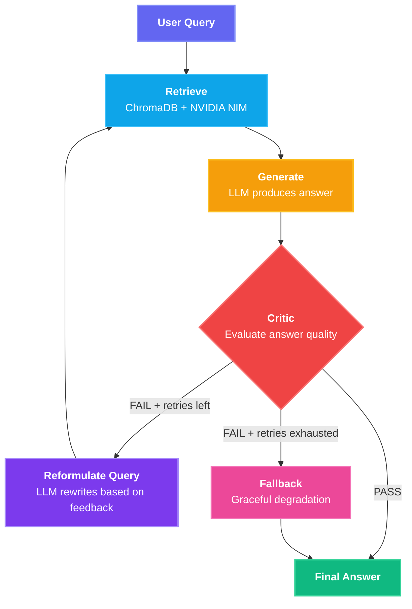

# Self-Healing RAG Pipeline

A RAG pipeline that checks its own work. The LLM writes an answer, a critic reviews it, and if it's not good enough — it rewrites the question and tries again. No more hallucinated or poorly grounded answers.

## Architecture



## How it works

1. **Retrieve** — Grab relevant document chunks from ChromaDB
2. **Generate** — LLM writes an answer using only those chunks
3. **Critique** — A critic scores the answer (accuracy, grounding, relevance)
4. **Self-correct** — If the critic rejects it, the query gets rewritten and we loop back to step 1. After max retries, it returns: *"I don't have enough information to answer that question."*

## Example

```
> What is a self-healing RAG pipeline?

🔍 Retrieve → searched 4 documents
✏️  Generate → wrote a 342-character answer
🔍 Critique → score 0.92 ✅ PASS

Output: A self-healing RAG pipeline is a system that uses a critic agent
to verify its generated answers against source documents...
```

If the critic finds problems:

```
🔍 Critique → score 0.30 ❌ FAIL
   "Answer contains claims not in the retrieved documents."
🔁 Reformulate → rewrote query for better search
🔍 Retrieve → searched again
✏️  Generate → corrected answer
🔍 Critique → score 0.95 ✅ PASS
```

If retries run out, it says: *"I don't have enough information to answer that question."*

## Project structure

```
├── run.py                    
├── test_pipeline.py          
├── .env.example
├── pyproject.toml
└── src/self_healing_rag/
    ├── state.py, vector_store.py, generator.py
    ├── critic.py, rate_limiter.py
    └── graph.py, main.py
```

## Tech stack

Built with LangGraph · ChromaDB · OpenRouter

## Author

**Vinesh**

Built with ❤️
